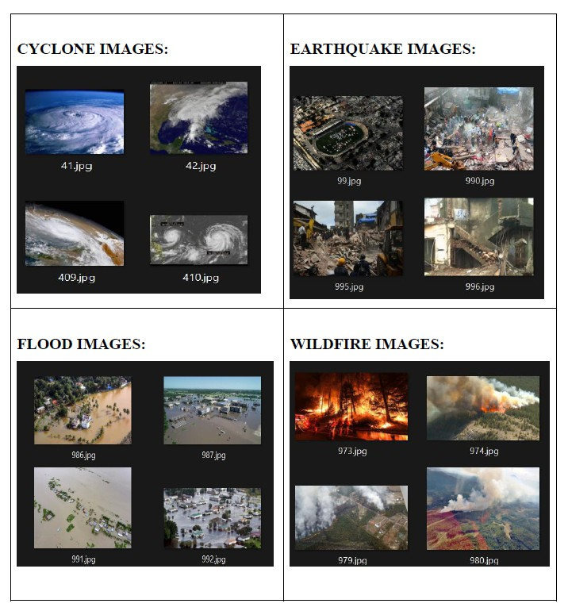
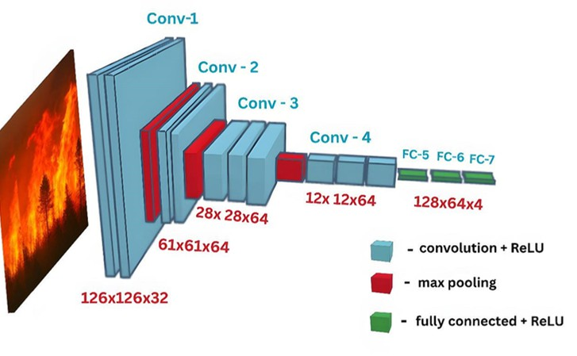
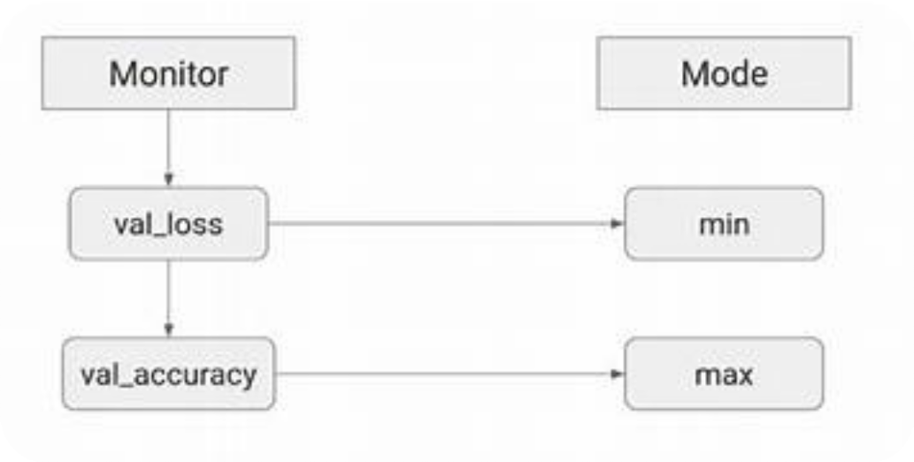
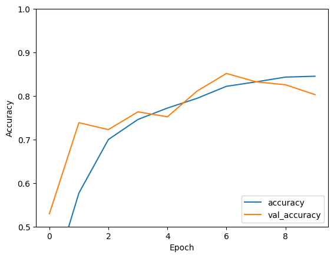
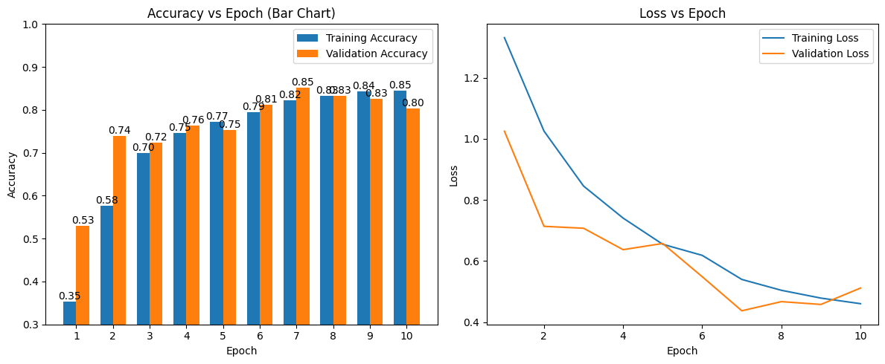
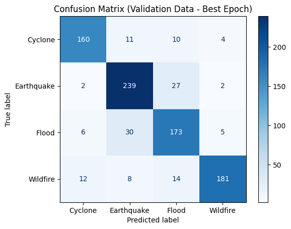
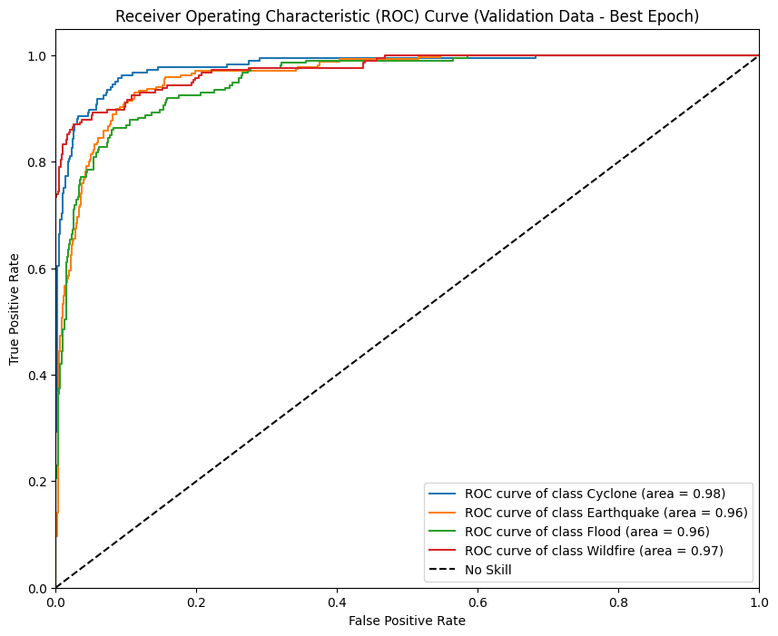
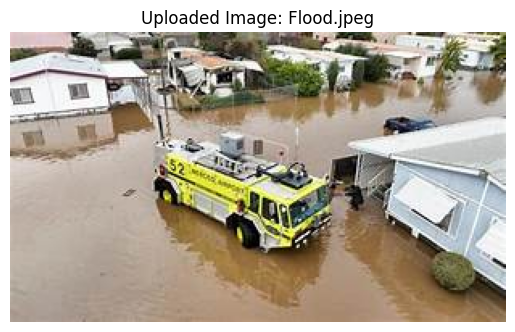
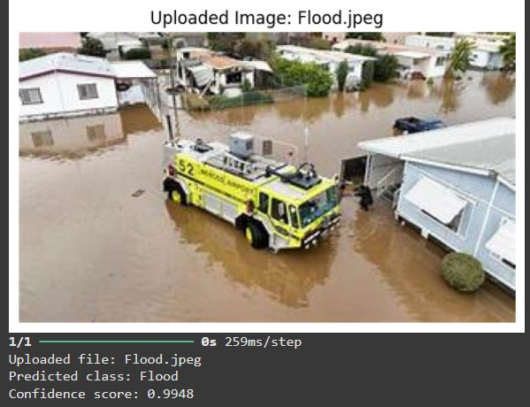

# CNN Disaster Classifier

A convolutional neural network (CNN) image-classification project for four natural-disaster categories: **Cyclone, Earthquake, Flood, and Wildfire**. This repository preserves the notebook, its saved outputs, selected figures from those outputs, and diagrams from the presentation deck.

> **Saved-results project:** the source image archive is not included. The notebook has not been rerun as part of this repository preparation, and the figures and metrics below are preserved from the supplied notebook and presentation.

## At a glance

| | |
|---|---|
| **Task** | Four-class image classification |
| **Model** | CNN implemented with TensorFlow/Keras |
| **Input** | RGB images resized to 128 × 128 and rescaled to [0, 1] |
| **Saved split** | 3,544 training images and 884 validation images |
| **Saved validation accuracy** | 85.18% at the selected epoch |
| **Data source** | An external ZIP archive; not included in this repository |

## Dataset examples

The presentation includes examples of the four image classes. They illustrate the task and are not a substitute for the complete training dataset.

## Model and workflow

The notebook's sequential CNN uses four convolution layers, three max-pooling layers, dropout, and two hidden dense layers before a four-logit output. It trains with categorical cross-entropy from logits and selects model checkpoints using validation loss.

The presentation also illustrates the validation metrics monitored during model selection:

## Preserved validation results

The figures and metrics below are saved notebook outputs, not results from a new run. The report evaluates the notebook's validation split (884 images); it is not an independent test-set result.

| Class | Precision | Recall | F1-score | Support |
|---|---:|---:|---:|---:|
| Cyclone | 0.89 | 0.86 | 0.88 | 185 |
| Earthquake | 0.83 | 0.89 | 0.86 | 270 |
| Flood | 0.77 | 0.81 | 0.79 | 214 |
| Wildfire | 0.94 | 0.84 | 0.89 | 215 |
| **Overall accuracy** |  |  | **0.85** | **884** |

The saved output reports a selected epoch of 7, validation loss of 0.4372, and validation accuracy of 0.8518. Its one-vs-rest validation AUC scores are 0.9799 (Cyclone), 0.9623 (Earthquake), 0.9555 (Flood), and 0.9744 (Wildfire). These are historical outputs; they do not establish real-world or emergency-response performance.

### Training and evaluation figures

| Accuracy history | Loss history |
|---|---|
|  |  |

| Validation confusion matrix | Validation ROC curves |
|---|---|
|  |  |

### Example prediction

The notebook output shows a single uploaded flood image classified as **Flood**, with a saved confidence score of **0.9948**. This is an illustrative, single-image prediction, not a held-out test result; the score should not be interpreted as calibrated certainty.

The presentation contains its own copy of the same prediction example:

## Repository contents

- [`CNN_Disaster_Classifier.ipynb`](CNN_Disaster_Classifier.ipynb) — notebook source and preserved cell outputs.
- [`CNN_Disaster_Classifier Presentation Deck.pptx`](<CNN_Disaster_Classifier Presentation Deck.pptx>) — project presentation.
- [`assets/figures/`](assets/figures/) — selected copies of saved notebook figures and presentation visuals used on this page.
- [`.gitignore`](.gitignore) — excludes local datasets, training artifacts, and the local-only field guide.

## Data and reproduction

The notebook expects an authorized `images.zip` archive at `/content/drive/MyDrive/CVNLP Assignment Work/images.zip` in Google Drive. It extracts the archive into an `images/` directory, which should contain one subdirectory per class. The saved notebook output identifies the four classes as `Cyclone`, `Earthquake`, `Flood`, and `Wildfire`.

The accompanying report identifies the source as the [Cyclone-Wildfire-Flood-Earthquake Database on Kaggle](https://www.kaggle.com/datasets/rupakroy/cyclone-wildfire-flood-earthquake-database), curated by Rupak Roy et al. The Kaggle page currently identifies version 2 and lists a CC0: Public Domain license. Review the dataset page, version, and license details when downloading; the page warns that images may be noisy, classes are imbalanced, and duplicates may remain. The report gives these class counts:

| Class | Images reported in the source |
|---|---:|
| Cyclone | 928 |
| Earthquake | 1,350 |
| Flood | 1,073 |
| Wildfire | 1,077 |
| **Total** | **4,428** |

These are source-reported counts; the archive has not been independently audited here. Cite the dataset and its version if you use it, and verify the current license and any applicable source-image terms before redistribution.

### Get the data and run the notebook

1. Download the dataset ZIP from the [Kaggle dataset page](https://www.kaggle.com/datasets/rupakroy/cyclone-wildfire-flood-earthquake-database) (Kaggle sign-in may be required). Note the version you downloaded; the current page lists version 2. The archive is large (about 3.3 GB), so allow for download time and sufficient Drive storage.
2. Keep the original ZIP outside the repository. In Google Drive, place a working copy at `/content/drive/MyDrive/CVNLP Assignment Work/images.zip`, which is the path expected by the notebook. Do not upload Kaggle API credentials or tokens into the notebook or repository.
3. Before training, inspect the archive and confirm that extracting it produces the four class directories `Cyclone`, `Earthquake`, `Flood`, and `Wildfire` directly under `images/`. If the archive has an extra enclosing directory, adjust the extraction/data path rather than silently training on an incorrect folder structure.
4. Audit the files before splitting: remove unreadable or irrelevant images, check for exact and near-duplicate images, and avoid placing related/duplicate images on both sides of an evaluation split. The Kaggle page specifically notes noise, class imbalance, and possible remaining duplicates.
5. Open the notebook in Google Colab and run cells in order only after confirming the dataset layout and available storage/runtime. The notebook uses an 80/20 `ImageDataGenerator` validation split and does not set a random seed; for repeatable or stronger evaluation, record the data version, split, and environment, and reserve an independent test set.

The archive is not included, so a fresh run is not reproducible from this repository alone. The report describes the original environment as Google Colab with TensorFlow 2.18.0 and GPU-backed execution, but the exact runtime and accelerator are not recorded in the notebook. The notebook imports TensorFlow/Keras, NumPy, pandas, Matplotlib, scikit-learn, and Google Colab's Drive and file-upload helpers. Changing the data, runtime, or package versions may change the results.

The report also describes horizontal flipping and small rotations as data augmentation. The notebook's configured `ImageDataGenerator` only rescales pixels and creates the validation split; it does not configure those augmentation transforms. The notebook is the implementation of record for this repository.

**Do not commit the source dataset or derived training files.** Dataset directories, common tabular/archive formats, checkpoints, and local-only documentation are ignored by Git; confirm staged files before committing.

The accompanying PDF report is intentionally not included: it contains student identifiers and assessment declaration material. Its relevant project details have been summarized here without publishing those personal records.

## Limitations

- The project performs image classification; it is not a disaster-detection service or a deployed warning system.
- Only the preserved validation evaluation is documented here. No independent test-set evaluation is provided.
- The source archive and a complete environment lockfile are not included.
- Dataset composition, labeling quality, class balance, and possible train/validation leakage have not been independently audited.
- Validation metrics and a single prediction do not establish reliability on new locations, image sources, or real emergencies.

## Contributors

Code and project contributions are collectively acknowledged to the contributors named in the supplied materials: **Abdelrahman Mahmoud Mohamed Afifi Mohamed**, **Syed Athif Usman**, **Muhammad Shabir Abdul Razick**, **Rozin Khan**, and **Shariar Hossain Istiq**. The source materials do not map individual names to specific code or presentation tasks.
